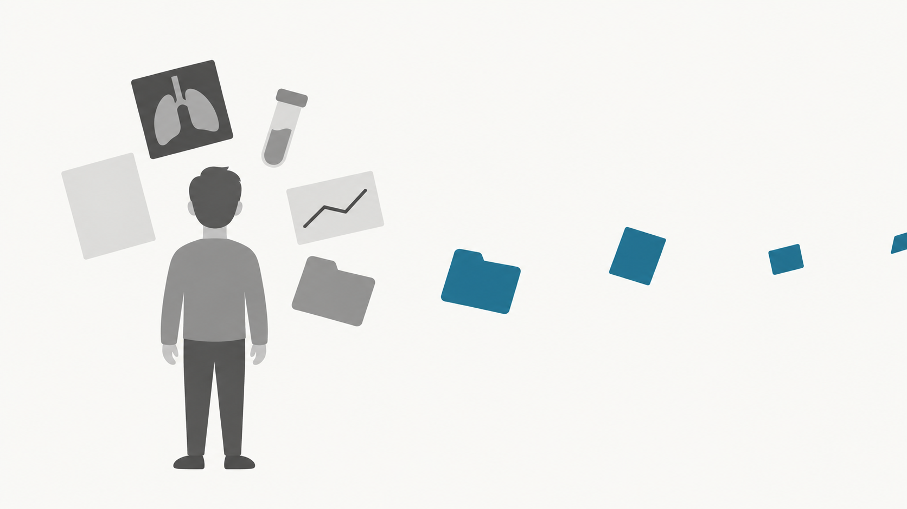
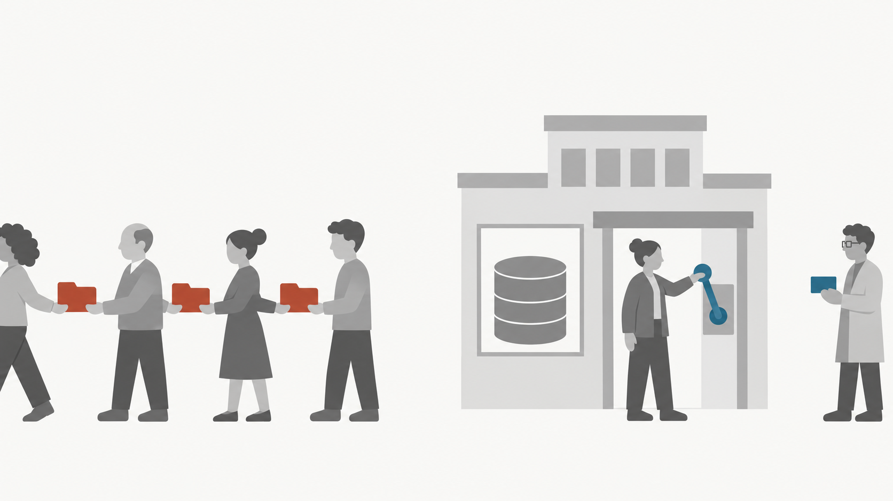

## {#s01 .titolo}

::: {.tit}
Sanità digitale sicura e sostenibile
:::

::: {.sottotitolo}
Le domande viaggiano, i dati restano.
:::

::: {.autore}
Corrado Lanera
:::

::: {.affiliazioni}
Università di Padova, Unità di Biostatistica, Epidemiologia e Sanità Pubblica

Istituto di Ricerca Pediatrica Città della Speranza
:::

::: {.luogo}
Digital Security Festival 2026, Padova, 4 novembre 2026
:::

::: {.nota-ia}
Testi, immagini e slide preparati con il supporto di strumenti di intelligenza artificiale generativa. Contenuti, scelte e verifiche sono dell'autore.
:::


## Quando i vostri dati entrano in una ricerca, dove vanno? {#s02}

{.immagine fig-alt="Una persona di spalle; i frammenti della sua storia clinica si allontanano verso destra."}


## Studi su più centri: l'approccio centralizzato sposta i dati {#s03}

```{=html}
<svg class="schema" viewBox="0 0 1760 800" role="img" aria-label="Due ospedali mandano copie dei dati a un archivio centrale, dove li analizza chi fa ricerca; ogni copia è un posto in più da proteggere.">
  <use href="#osp-dati" x="60" y="70" width="168" height="140"/>
  <text x="40" y="258" class="p">troppo pochi pazienti</text>
  <use href="#osp-dati" x="40" y="420" width="240" height="200"/>
  <text x="40" y="668" class="p">pazienti troppo simili</text>
  <rect x="580" y="120" width="720" height="520" rx="28" fill="#E5E5E2"/>
  <use href="#copia" x="640" y="180" width="90" height="110"/><use href="#copia" x="800" y="180" width="90" height="110"/><use href="#copia" x="960" y="180" width="90" height="110"/><use href="#copia" x="1120" y="180" width="90" height="110"/>
  <use href="#copia" x="640" y="360" width="90" height="110"/><use href="#copia" x="800" y="360" width="90" height="110"/><use href="#copia" x="960" y="360" width="90" height="110"/><use href="#copia" x="1120" y="360" width="90" height="110"/>
  <text x="940" y="585" class="m">archivio centrale</text>
  <path d="M236 140 L572 250" stroke="#9A9A96" stroke-width="3" marker-end="url(#fg)"/>
  <path d="M288 520 L572 452" stroke="#9A9A96" stroke-width="3" marker-end="url(#fg)"/>
  <use href="#copia" x="373" y="140" width="64" height="78"/>
  <use href="#copia" x="399" y="437" width="64" height="78"/>
  <path d="M1306 380 H1480" stroke="#9A9A96" stroke-width="3" marker-end="url(#fg)"/>
  <use href="#pers" class="g" x="1500" y="298" width="120" height="165"/>
  <text x="1560" y="513" class="m">chi fa ricerca</text>
  <text x="880" y="775" class="p m">centralizzato: i dati si copiano in un archivio; <tspan fill="#B5452F">ogni copia, un posto in più da proteggere</tspan></text>
</svg>
```


## Studi su più centri: l'approccio federato sposta l'analisi {#s04}

```{=html}
<svg class="schema" viewBox="0 0 1760 800" role="img" aria-label="Gli stessi due ospedali tengono i dati; verso di loro chi fa ricerca manda una domanda (analisi federata), lo stesso modello da allenare (apprendimento federato) o un generatore di dati (dati sintetici).">
  <use href="#osp-dati" x="60" y="70" width="168" height="140"/>
  <text x="40" y="258" class="p">troppo pochi pazienti</text>
  <use href="#osp-dati" x="40" y="420" width="240" height="200"/>
  <text x="40" y="668" class="p">pazienti troppo simili</text>
  <rect x="580" y="120" width="720" height="520" rx="28" fill="#E5E5E2"/>
  <use href="#busta" class="a" x="630" y="160" width="120" height="84"/>
  <text x="790" y="195" class="t">analisi federata</text>
  <text x="790" y="242" class="p">va una domanda</text>
  <use href="#ingr" class="a" x="640" y="330" width="100" height="100"/>
  <text x="790" y="370" class="t">apprendimento federato</text>
  <text x="790" y="417" class="p">va un modello da allenare</text>
  <use href="#scint" class="a" x="640" y="500" width="100" height="100"/>
  <text x="790" y="540" class="t">dati sintetici</text>
  <text x="790" y="587" class="p">va un generatore di dati</text>
  <path d="M580 250 L244 143" stroke="#9A9A96" stroke-width="3" marker-end="url(#fg)"/>
  <path d="M580 452 L296 518" stroke="#9A9A96" stroke-width="3" marker-end="url(#fg)"/>
  <use href="#busta" class="a" x="471" y="206" width="50" height="35"/>
  <use href="#ingr" class="a" x="390" y="174" width="44" height="44"/>
  <use href="#scint" class="a" x="306" y="148" width="44" height="44"/>
  <use href="#busta" class="a" x="484" y="451" width="50" height="35"/>
  <use href="#ingr" class="a" x="416" y="463" width="44" height="44"/>
  <use href="#scint" class="a" x="345" y="479" width="44" height="44"/>
  <path d="M1480 380 H1306" stroke="#9A9A96" stroke-width="3" marker-end="url(#fg)"/>
  <use href="#pers" class="g" x="1500" y="298" width="120" height="165"/>
  <text x="1560" y="513" class="m">chi fa ricerca</text>
  <text x="880" y="775" class="p m">federato: i centri restano autonomi e collaborano <tspan fill="#1F6F8B">senza mettere in comune i dati</tspan></text>
</svg>
```


## Analisi federata {#t1 .sezione}

```{=html}
<svg class="icona-sezione" viewBox="0 0 120 84"><use href="#busta"/></svg>
```

::: {.inglese}
federated analysis
:::

::: {.cosa}
**Che cos'è.** Un'analisi statistica su dati che restano in più centri: ogni centro esegue lo stesso calcolo sui propri dati e restituisce solo risultati aggregati, che chi analizza combina.
:::

## Calcoli nei centri, risultato globale {#s05 .con-mossa}

```{=html}
<div class="mossa"><svg viewBox="0 0 120 84"><use href="#busta"/></svg><span>analisi federata · come funziona</span></div>
<svg class="schema" viewBox="0 0 1760 800" role="img" aria-label="L'analista manda a tre ospedali la stessa domanda: di quanto scende in media la glicemia con la terapia. Ogni ospedale restituisce il numero di pazienti e la media: 30 pazienti e 24, 45 e 18, 25 e 30. Con questi numeri la media di tutti, 22,8, è uguale a quella calcolata sui dati riuniti.">
  <use href="#osp-dati" x="40" y="40" width="168" height="140"/>
  <use href="#osp-dati" x="40" y="250" width="168" height="140"/>
  <use href="#osp-dati" x="40" y="460" width="168" height="140"/>
  <g fill="none" stroke="#9A9A96" stroke-width="3" marker-end="url(#fg)">
    <path d="M1450 252 C1270 252 1270 105 1080 105 H226"/>
    <path d="M1450 300 C1270 300 1270 315 1080 315 H226"/>
    <path d="M1450 348 C1270 348 1270 525 1080 525 H226"/>
    <path d="M226 160 H1080 C1270 160 1270 276 1446 276"/>
    <path d="M226 370 H1080 C1270 370 1270 324 1446 324"/>
    <path d="M226 580 H1080 C1270 580 1270 372 1446 372"/>
  </g>
  <text x="920" y="88" class="e">«quanto scende in media la glicemia?»</text>
  <use href="#busta" class="a" x="940" y="63" width="120" height="84"/>
  <use href="#busta" class="a" x="940" y="273" width="120" height="84"/>
  <use href="#busta" class="a" x="940" y="483" width="120" height="84"/>
  <g fill="#1F6F8B">
    <path d="M420 160 L452 124 H920 V196 H452 Z"/>
    <path d="M420 370 L452 334 H920 V406 H452 Z"/>
    <path d="M420 580 L452 544 H920 V616 H452 Z"/>
  </g>
  <g fill="#FAFAF7"><circle cx="444" cy="160" r="6"/><circle cx="444" cy="370" r="6"/><circle cx="444" cy="580" r="6"/></g>
  <text x="686" y="174" class="n m">30 pazienti, media 24</text>
  <text x="686" y="384" class="n m">45 pazienti, media 18</text>
  <text x="686" y="594" class="n m">25 pazienti, media 30</text>
  <use href="#pers" class="g" x="1440" y="230" width="120" height="165"/>
  <text x="1500" y="445" class="m">analista</text>
  <path d="M180 690 L212 654 H740 V726 H212 Z" fill="#6E6E6B"/><circle cx="204" cy="690" r="6" fill="#FAFAF7"/>
  <text x="476" y="704" class="n m">dati riuniti: media 22,8</text>
  <text x="800" y="712" class="t m" style="font-size:64px">=</text>
  <path d="M860 690 L892 654 H1380 V726 H892 Z" fill="#1F6F8B"/><circle cx="884" cy="690" r="6" fill="#FAFAF7"/>
  <text x="1136" y="704" class="n m">federata: media 22,8</text>
  <text x="800" y="785" class="p m">(30 × 24 + 45 × 18 + 25 × 30) / 100 = 22,8</text>
</svg>
```


## Controlli e formato comune in ogni centro {#s06 .con-mossa}

```{=html}
<div class="mossa"><svg viewBox="0 0 120 84"><use href="#busta"/></svg><span>analisi federata · come funziona</span></div>
<svg class="schema" viewBox="0 0 1760 800" role="img" aria-label="Un ospedale visto da vicino: alla porta d'ingresso una chiave e un registro; dentro, la traduzione da età o data di nascita a un formato comune; all'uscita passa la media di 30 pazienti, mentre la media di un solo paziente, che è il suo valore, è fermata; la soglia la decide il centro, per esempio almeno 5 pazienti.">
  <rect x="380" y="150" width="1000" height="620" fill="#E5E5E2"/>
  <rect x="800" y="40" width="160" height="110" fill="#C9C9C5"/>
  <path d="M868 63 h24 v20 h20 v24 h-20 v20 h-24 v-20 h-20 v-24 h20 z" fill="#FAFAF7"/>
  <rect x="380" y="600" width="80" height="170" fill="#C9C9C5"/>
  <rect x="1300" y="600" width="80" height="170" fill="#C9C9C5"/>
  <rect x="685" y="300" width="150" height="64" rx="8" fill="#C9C9C5"/>
  <text x="760" y="345" class="m">età</text>
  <rect x="595" y="400" width="330" height="64" rx="8" fill="#C9C9C5"/>
  <text x="760" y="445" class="m">data di nascita</text>
  <use href="#dati" x="700" y="520" width="120" height="150"/>
  <path d="M843 336 L976 370" stroke="#9A9A96" stroke-width="3" marker-end="url(#fg)"/>
  <path d="M933 430 L976 404" stroke="#9A9A96" stroke-width="3" marker-end="url(#fg)"/>
  <rect x="985" y="351" width="370" height="72" rx="8" fill="#C9C9C5"/>
  <text x="1170" y="400" class="t m">formato comune</text>
  <text x="40" y="430" class="t">chi interroga</text>
  <text x="40" y="485">identificato,</text>
  <text x="40" y="532">autorizzato,</text>
  <text x="40" y="579">registrato</text>
  <use href="#registro" class="g" x="40" y="640" width="70" height="90"/>
  <use href="#chiave" class="g" x="150" y="660" width="200" height="83"/>
  <text x="1420" y="570" class="t">che cosa esce</text>
  <rect x="1300" y="600" width="12" height="170" fill="#B5452F"/>
  <text x="1068" y="652" class="e">30 pazienti:</text>
  <path d="M1080 640 H1428" stroke="#9A9A96" stroke-width="3" marker-end="url(#fg)"/>
  <path d="M1440 640 L1472 604 H1680 V676 H1472 Z" fill="#1F6F8B"/><circle cx="1464" cy="640" r="6" fill="#FAFAF7"/>
  <text x="1576" y="654" class="n m">media 24</text>
  <text x="1068" y="742" class="e">1 paziente:</text>
  <rect x="1080" y="696" width="180" height="64" rx="6" fill="#6E6E6B"/>
  <text x="1170" y="742" class="n m">media 31</text>
  <path d="M1264 728 H1290" stroke="#9A9A96" stroke-width="3" marker-end="url(#fg)"/>
  <text x="1400" y="740">la media di 1 paziente</text>
  <text x="1400" y="787">è il suo valore:</text>
  <text x="1400" y="834">non esce</text>
  <text x="880" y="830" class="p m">soglia decisa dal centro, per esempio almeno 5 pazienti</text>
</svg>
```


## Chi controlla l'accesso ai dati {#s07 .con-mossa}

```{=html}
<div class="mossa"><svg viewBox="0 0 120 84"><use href="#busta"/></svg><span>analisi federata · che cosa cambia</span></div>
```

```{=html}
<div class="sim-volo">
  
  <div class="didascalie"><div><b style="color:#B5452F">copia dei dati</b>: passa di mano in mano, non si ritira</div><div><b>analisi federata</b>: il centro concede e revoca l’accesso; escono solo risultati</div></div>
</div>
```


## Limiti dell'analisi federata {#s08 .con-mossa}

```{=html}
<div class="mossa"><svg viewBox="0 0 120 84"><use href="#busta"/></svg><span>analisi federata · limiti</span></div>
<div class="limiti">
  <svg viewBox="20 230 405 175" role="img" aria-label="Più risultati aggregati che, confrontati, isolano una persona">
    <g fill="#9A9A96" stroke="#FAFAF7" stroke-width="4">
      <path d="M28 270 L56 238 H178 V302 H56 Z"/>
      <path d="M50 318 L78 286 H200 V350 H78 Z"/>
      <path d="M72 366 L100 334 H222 V398 H100 Z"/>
    </g>
    <path d="M238 318 H288" stroke="#9A9A96" stroke-width="5" marker-end="url(#fg)"/>
    <use href="#pers" class="r" x="306" y="244" width="110" height="151"/>
  </svg>
  <p><b>Domande combinate</b><br>31 pazienti in tutto, 30 sotto gli 80 anni: la differenza è una persona</p>
  <svg viewBox="0 0 140 70" role="img" aria-label="Una maschera">
    <use href="#maschera" class="g" width="140" height="70"/>
    <ellipse cx="42" cy="32" rx="10.8" ry="2.7" fill="#B5452F"/>
    <ellipse cx="98" cy="32" rx="10.8" ry="2.7" fill="#B5452F"/>
  </svg>
  <p><b>Pseudonimizzati, non anonimi</b><br>un codice al posto del nome; con la chiave o altre fonti si risale alla persona</p>
  <svg viewBox="1010 120 280 250" role="img" aria-label="Una lampadina che sembra accesa, con la spina staccata">
    <g stroke="#9A9A96" stroke-width="4" stroke-linecap="round">
      <path d="M1100 150 V128"/><path d="M1142 168 L1157 153"/><path d="M1058 168 L1043 153"/><path d="M1160 210 H1180"/><path d="M1040 210 H1020"/>
    </g>
    <circle cx="1100" cy="210" r="44" fill="#C9C9C5"/>
    <rect x="1078" y="256" width="44" height="24" fill="#6E6E6B"/>
    <path d="M1100 280 V340 H1150" fill="none" stroke="#6E6E6B" stroke-width="5"/>
    <rect x="1150" y="326" width="36" height="28" fill="#6E6E6B"/>
    <rect x="1186" y="331" width="14" height="5" fill="#6E6E6B"/><rect x="1186" y="344" width="14" height="5" fill="#6E6E6B"/>
    <path d="M1206 340 H1236" stroke="#B5452F" stroke-width="5" stroke-dasharray="7 5"/>
    <rect x="1240" y="318" width="40" height="44" rx="4" fill="#9A9A96"/>
  </svg>
  <p><b>Errori che non si vedono</b><br>una protezione spenta per sbaglio, mentre il sistema risponde come sempre</p>
  <svg viewBox="0 0 240 250" role="img" aria-label="Un ospedale con due soli pazienti">
    <use href="#osp-dati" width="240" height="200"/>
    <circle cx="100" cy="232" r="15" fill="#B5452F"/><circle cx="140" cy="232" r="15" fill="#B5452F"/>
  </svg>
  <p><b>Casi rari</b><br>pochi pazienti per centro: le protezioni bloccano le risposte</p>
</div>
```


## Apprendimento federato {#t2 .sezione}

```{=html}
<svg class="icona-sezione" viewBox="-50 -50 100 100"><use href="#ingr" x="-50" y="-50" width="100" height="100"/></svg>
```

::: {.inglese}
federated learning
:::

::: {.cosa}
**Che cos'è.** Un modello di apprendimento automatico (machine learning) allenato su dati che restano in più centri: il coordinatore manda a tutti lo stesso modello, ogni centro lo allena sui propri dati e rimanda solo i suoi aggiornamenti, non i dati.
:::


## Allenamento nei centri, aggiornamenti al coordinatore {#s09 .con-mossa}

```{=html}
<div class="mossa"><svg viewBox="-50 -50 100 100"><use href="#ingr" x="-50" y="-50" width="100" height="100"/></svg><span>apprendimento federato · come funziona</span></div>
<svg class="schema" viewBox="0 0 1760 800" role="img" aria-label="Un ciclo che si ripete: 1, il coordinatore manda lo stesso modello a tutti i centri; 2, ogni centro lo allena sui propri dati; 3, ogni centro rimanda il suo aggiornamento; 4, il coordinatore combina gli aggiornamenti in un nuovo modello comune, e si ricomincia.">
  <!-- il giro: andata in alto, ritorno in basso -->
  <g fill="none" stroke="#9A9A96" stroke-width="4" marker-end="url(#fg)">
    <path d="M391 304 A520 280 0 0 1 1369 304"/>
    <path d="M1369 496 A520 280 0 0 1 391 496"/>
  </g>
  <!-- 1. lo stesso modello va a tutti -->
  <use href="#ingr" class="a" x="845" y="85" width="70" height="70"/>
  <text x="880" y="62" class="m"><tspan fill="#1F6F8B" font-weight="700">1</tspan>  lo stesso modello a tutti i centri</text>
  <!-- 2. ogni centro lo allena sui propri dati -->
  <use href="#osp-dati" x="1440" y="190" width="144" height="120"/>
  <use href="#ingr" class="a" x="1449" y="246" width="38" height="38"/>
  <use href="#osp-dati" x="1440" y="340" width="144" height="120"/>
  <use href="#ingr" class="a" x="1449" y="396" width="38" height="38"/>
  <use href="#osp-dati" x="1440" y="490" width="144" height="120"/>
  <use href="#ingr" class="a" x="1449" y="546" width="38" height="38"/>
  <text x="1512" y="670" class="m"><tspan fill="#1F6F8B" font-weight="700">2</tspan>  ogni centro</text>
  <text x="1512" y="717" class="m">lo allena sui suoi dati</text>
  <!-- 3. tornano aggiornamenti diversi -->
  <use href="#corr" class="a" x="796" y="650" width="48" height="60" transform="rotate(-12 820 680)"/>
  <use href="#corr" class="a" x="856" y="650" width="48" height="60"/>
  <use href="#corr" class="a" x="916" y="650" width="48" height="60" transform="rotate(12 940 680)"/>
  <text x="880" y="770" class="m"><tspan fill="#1F6F8B" font-weight="700">3</tspan>  ogni centro rimanda il suo aggiornamento</text>
  <!-- 4. il coordinatore li combina -->
  <use href="#ingr" class="a" x="40" y="340" width="120" height="120"/>
  <use href="#pers" class="g" x="190" y="318" width="120" height="165"/>
  <text x="200" y="530" class="m">coordinatore</text>
  <text x="200" y="600" class="m"><tspan fill="#1F6F8B" font-weight="700">4</tspan>  li combina in un</text>
  <text x="200" y="647" class="m">nuovo modello comune</text>
  <!-- e si ricomincia -->
  <text x="880" y="380" class="t m">si ripete per molti giri:</text>
  <text x="880" y="430" class="p m">un numero fissato prima, o finché</text>
  <text x="880" y="477" class="p m">il modello smette di migliorare</text>
</svg>
```


## Analisi federata e apprendimento federato a confronto {#s10 .con-mossa}

```{=html}
<div class="mossa"><svg viewBox="-50 -50 100 100"><use href="#ingr" x="-50" y="-50" width="100" height="100"/></svg><span>apprendimento federato · che cosa cambia, limiti</span></div>
<svg class="schema" viewBox="0 0 1760 800" role="img" aria-label="A sinistra, analisi federata: tre ospedali restituiscono all'analista tasselli che combaciano esattamente, uguale ai dati riuniti, per conteggi, medie e molti modelli, ma i risultati possono esporre dati. A destra, apprendimento federato: tre ospedali mandano al coordinatore aggiornamenti diversi, che lui combina per più giri; il risultato dipende da come si allena, e gli aggiornamenti possono esporre dati.">
  <use href="#busta" class="a" x="0" y="8" width="72" height="50"/>
  <text x="92" y="48" class="t">analisi federata</text>
  <use href="#ingr" class="a" x="900" y="2" width="58" height="58"/>
  <text x="978" y="48" class="t">apprendimento federato</text>
  <!-- analisi federata: pezzi esatti di un unico calcolo -->
  <use href="#osp-dati" x="0" y="110" width="144" height="120"/>
  <use href="#osp-dati" x="0" y="310" width="144" height="120"/>
  <use href="#osp-dati" x="0" y="510" width="144" height="120"/>
  <g stroke="#9A9A96" stroke-width="3" marker-end="url(#fg)">
    <path d="M150 170 L500 305"/><path d="M150 370 L500 320"/><path d="M150 570 L500 335"/>
  </g>
  <g fill="#1F6F8B" stroke="#FAFAF7" stroke-width="4">
    <path transform="translate(301 207) scale(0.6)" d="M0 0 H70 V35 A15 15 0 0 1 70 65 V100 H0 Z"/>
    <path transform="translate(259 315) scale(0.6)" d="M70 0 H140 V35 A15 15 0 0 1 140 65 V100 H70 V65 A15 15 0 0 0 70 35 Z"/>
    <path transform="translate(220 422) scale(0.6)" d="M140 0 H210 V100 H140 V65 A15 15 0 0 0 140 35 Z"/>
    <g transform="translate(482 450) scale(0.75)">
      <path d="M0 0 H70 V35 A15 15 0 0 1 70 65 V100 H0 Z"/>
      <path d="M70 0 H140 V35 A15 15 0 0 1 140 65 V100 H70 V65 A15 15 0 0 0 70 35 Z"/>
      <path d="M140 0 H210 V100 H140 V65 A15 15 0 0 0 140 35 Z"/>
    </g>
  </g>
  <use href="#pers" class="g" x="510" y="230" width="100" height="137"/>
  <text x="560" y="410" class="m">analista</text>
  <text x="560" y="650" class="t m">= dati riuniti</text>
  <text x="560" y="705" class="p m">per conteggi, medie e molti modelli</text>
  <text x="560" y="760" class="r m">i risultati possono esporre dati</text>
  <!-- apprendimento federato: allenamenti da combinare, per più giri -->
  <use href="#osp-dati" x="900" y="110" width="144" height="120"/>
  <use href="#osp-dati" x="900" y="310" width="144" height="120"/>
  <use href="#osp-dati" x="900" y="510" width="144" height="120"/>
  <g stroke="#9A9A96" stroke-width="3" marker-end="url(#fg)">
    <path d="M1050 170 L1420 305"/><path d="M1050 370 L1420 320"/><path d="M1050 570 L1420 335"/>
  </g>
  <text x="1235" y="190" class="m">aggiornamenti</text>
  <use href="#corr" class="a" x="1211" y="207" width="48" height="60" transform="rotate(-12 1235 237)"/>
  <use href="#corr" class="a" x="1211" y="315" width="48" height="60"/>
  <use href="#corr" class="a" x="1211" y="422" width="48" height="60" transform="rotate(12 1235 452)"/>
  <path d="M1368.4 270.1 A140 140 0 1 1 1368.4 365.9" fill="none" stroke="#9A9A96" stroke-width="3" marker-end="url(#fg)"/>
  <text x="1590" y="200">più giri</text>
  <use href="#pers" class="g" x="1450" y="250" width="100" height="137"/>
  <text x="1500" y="505" class="m">coordinatore</text>
  <text x="1380" y="650" class="t m">dipende da come si allena</text>
  <text x="1380" y="705" class="p m">e da quanto differiscono i centri</text>
  <text x="1380" y="760" class="r m">gli aggiornamenti possono esporre dati</text>
</svg>
```


## Dati sintetici e biobanca digitale {#t3 .sezione}

```{=html}
<svg class="icona-sezione" viewBox="-50 -50 100 100"><use href="#scint" x="-50" y="-50" width="100" height="100"/></svg>
```

::: {.inglese}
synthetic data, digital biobank
:::

::: {.cosa}
**Dati sintetici:** dati artificiali generati da un modello che ha imparato le proprietà statistiche di dati reali (per esempio come si legano età, diagnosi ed esiti); non sono i dati di pazienti reali.

**Biobanca:** conserva campioni biologici (sangue, tessuti, DNA) con le informazioni che li descrivono (tipo, data di raccolta, consenso) e li mette a disposizione della ricerca con regole di accesso. **Biobanca digitale:** lo stesso, con campioni digitali al posto di quelli biologici (cartelle cliniche, esami, immagini); qui, dati sintetici.
:::

## Generazione e verifica dei dati sintetici {#s11 .con-mossa}

```{=html}
<div class="mossa"><svg viewBox="-50 -50 100 100"><use href="#scint" x="-50" y="-50" width="100" height="100"/></svg><span>dati sintetici · come funziona</span></div>
<svg class="schema" viewBox="0 0 1760 800" role="img" aria-label="Un solo generatore si allena nei tre centri; produce dati sintetici, derivati da pazienti ma non copie; una prova con gli attacchi conosciuti, a confronto con i dati veri, lascia passare verso la biobanca digitale solo ciò che la supera, e ferma il resto.">
  <!-- un solo generatore, che si allena nei tre centri -->
  <use href="#osp-dati" x="40" y="40" width="168" height="140"/>
  <use href="#osp-dati" x="40" y="250" width="168" height="140"/>
  <use href="#osp-dati" x="40" y="460" width="168" height="140"/>
  <g stroke="#9A9A96" stroke-width="3" marker-start="url(#fg)" marker-end="url(#fg)">
    <path d="M232 112 L402 288"/><path d="M232 320 L398 320"/><path d="M232 528 L402 352"/>
  </g>
  <use href="#scint" class="a" x="410" y="260" width="120" height="120"/>
  <text x="470" y="432" class="m">generatore</text>
  <path d="M545 320 H622" stroke="#9A9A96" stroke-width="3" marker-end="url(#fg)"/>
  <!-- le persone tratteggiate escono dal generatore; una non passa la prova -->
  <text x="725" y="180" class="m">dati sintetici: derivati</text>
  <text x="725" y="227" class="m">da pazienti, non copie</text>
  <use href="#pers-s" class="a" x="640" y="250" width="80" height="110"/>
  <use href="#pers-s" class="a" x="730" y="250" width="80" height="110"/>
  <use href="#pers-s" class="r" x="685" y="390" width="80" height="110"/>
  <!-- il cancello della prova -->
  <text x="1092" y="70" class="t m">verifica del rischio:</text>
  <text x="1092" y="118" class="m">attacchi conosciuti</text>
  <path d="M990 165 L1052 232" stroke="#9A9A96" stroke-width="3" marker-end="url(#fg)"/>
  <path d="M1195 165 L1133 232" stroke="#9A9A96" stroke-width="3" marker-end="url(#fg)"/>
  <rect x="1080" y="150" width="24" height="110" fill="#4A4A48"/>
  <rect x="1080" y="370" width="24" height="230" fill="#4A4A48"/>
  <text x="1092" y="650" class="p m">vale solo per gli attacchi provati</text>
  <path d="M830 305 H1300" stroke="#9A9A96" stroke-width="3" marker-end="url(#fg)"/>
  <path d="M775 445 H1072" stroke="#9A9A96" stroke-width="3" marker-end="url(#fg)"/>
  <text x="925" y="428" class="r m">non rilasciato</text>
  <!-- il confronto con i dati veri -->
  <path d="M152 575 H1072" stroke="#9A9A96" stroke-width="3" stroke-dasharray="12 9" marker-end="url(#fg)"/>
  <text x="600" y="625" class="m">confronto con i dati veri</text>
  <!-- chi passa va verso la biobanca digitale -->
  <use href="#archivio" x="1320" y="170" width="380" height="300"/>
  <use href="#pers-s" class="a" x="1425" y="262" width="80" height="110"/>
  <use href="#pers-s" class="a" x="1515" y="262" width="80" height="110"/>
  <text x="1510" y="530" class="m">biobanca digitale</text>
</svg>
```


## A che cosa servono i dati sintetici {#s12 .con-mossa}

```{=html}
<div class="mossa"><svg viewBox="-50 -50 100 100"><use href="#scint" x="-50" y="-50" width="100" height="100"/></svg><span>dati sintetici · che cosa cambia, limiti</span></div>
<div class="sim-volo">
  
  <div class="didascalie"><div><b>dati sintetici</b>: provare i metodi</div><div><b>dati veri</b>: domande cliniche</div></div>
</div>
```


## Che cosa cambia {#s13 .risposta}

::: {.domanda-iniziale}
Quando i vostri dati entrano in una ricerca, dove vanno?
:::

::: {.sei-parole}
I dati possono restare presso chi li custodisce.
:::

```{=html}
<div class="visione">
  <svg viewBox="0 0 240 200"><use href="#osp-dati"/></svg>
  <div class="ambito">Ricerca fra più centri</div>
  <div>ogni centro tiene i suoi dati</div>
  <svg viewBox="0 0 120 50"><use href="#chiave" style="color:#8A8A87"/></svg>
  <div class="ambito">Uso dei dati sanitari</div>
  <div>il centro concede l’accesso e può revocarlo</div>
  <svg viewBox="0 0 110 92">
    <rect x="0" y="12" width="40" height="24" rx="4" fill="#C9C9C5"/>
    <rect x="0" y="56" width="40" height="24" rx="4" fill="#C9C9C5"/>
    <path d="M44 24 L66 42 M44 68 L66 50" stroke="#9A9A96" stroke-width="5"/>
    <rect x="68" y="34" width="42" height="24" rx="4" fill="#8A8A87"/>
  </svg>
  <div class="ambito">Formato comune</div>
  <div>tradotto una volta, riusato da tutti gli studi</div>
</div>
```


## {#s16 .contatti}

::: {.domande-piccole}
Per approfondire o collaborare:
:::

::: {.contatto}
Corrado Lanera, PhD

Tenure-Track Assistant Professor, UBEP, DCTV, UniPD

[Corrado.Lanera@ubep.unipd.it]{.mail} · @CorradoLanera
:::

::: {.contatto}
Prof. Dario Gregori

Head of UBEP, DCTV, UniPD · [Dario.Gregori@ubep.unipd.it]{.mail}

PI, BIOSTAT-X, IRP Città della Speranza · [biostat-x@ubep.unipd.it]{.mail}
:::

::: {.contatto}
Davide Ederle

Head of Innovation, IRP Città della Speranza ETS · [innovation@irpcds.org]{.mail}
:::


<!--
  Slide A: referenze verificate il 2026-11-04 una per una (record, DOI, pertinenza);
  esito e motivi delle scelte in intervento.md, «Slide delle referenze».
-->

## Referenze {#sA .referenze}

::: {.ref-colonne}
::: {.ref-gruppo}
**Analisi federata**

Gaye A et al. DataSHIELD: taking the analysis to the data, not the data to the analysis. *Int J Epidemiol* 2014;43(6):1929-44. doi:10.1093/ije/dyu188

Avraam D et al. DataSHIELD: mitigating disclosure risk in a multi-site federated analysis platform. *Bioinform Adv* 2025;5(1):vbaf046. doi:10.1093/bioadv/vbaf046

Dwork C et al. Exposed! A survey of attacks on private data. *Annu Rev Stat Appl* 2017;4:61-84. doi:10.1146/annurev-statistics-060116-054123

Rocher L, Hendrickx JM, de Montjoye YA. Estimating the success of re-identifications in incomplete datasets using generative models. *Nat Commun* 2019;10:3069. doi:10.1038/s41467-019-10933-3

Regolamento (UE) 2016/679 (GDPR), art. 4, punto 5, e considerando 26.
:::

::: {.ref-gruppo}
**Apprendimento federato**

McMahan HB et al. Communication-efficient learning of deep networks from decentralized data. *AISTATS* 2017, PMLR 54:1273-82.

Rieke N et al. The future of digital health with federated learning. *npj Digit Med* 2020;3:119. doi:10.1038/s41746-020-00323-1

Kairouz P et al. Advances and open problems in federated learning. *Found Trends Mach Learn* 2021;14(1-2):1-210. doi:10.1561/2200000083

Zhu L, Liu Z, Han S. Deep leakage from gradients. *NeurIPS* 2019.

Shokri R et al. Membership inference attacks against machine learning models. *IEEE S&P* 2017:3-18. doi:10.1109/SP.2017.41

Bonawitz K et al. Practical secure aggregation for privacy-preserving machine learning. *ACM CCS* 2017:1175-91. doi:10.1145/3133956.3133982
:::

::: {.ref-gruppo}
**Dati sintetici e biobanche**

Stadler T, Oprisanu B, Troncoso C. Synthetic data: anonymisation groundhog day. *USENIX Security* 2022:1451-68.

Jordon J et al. Synthetic data: what, why and how? Rapporto per la Royal Society, 2022. arXiv:2205.03257

Kaabachi B et al. A scoping review of privacy and utility metrics in medical synthetic data. *npj Digit Med* 2025;8:60. doi:10.1038/s41746-024-01359-3

Dwork C, Roth A. The algorithmic foundations of differential privacy. *Found Trends Theor Comput Sci* 2014;9(3-4):211-487. doi:10.1561/0400000042

OECD. Guidelines on human biobanks and genetic research databases. OECD, 2009.
:::

::: {.ref-gruppo}
**Strumenti e standard citati come esempi, non come raccomandazioni**

DataSHIELD (datashield.org) · Flower (flower.ai; Beutel DJ et al., arXiv:2007.14390) · OMOP Common Data Model v5.5 (ohdsi.github.io/CommonDataModel) · HL7 FHIR R5 (hl7.org/fhir)
:::
:::

